# 课程创建操作说明

本文档介绍如何在系统中创建课程。系统把课程分成两类：

- **Group Class（团课 / 班课）**：多个学生一起上课，按年级班（Grade Class）来管理，支持按月 / 按周 / 按课时报名。
- **1:1 Private（一对一私教）**：单个学生上课，按「课时包（Hour Package）」来报名。

两类课程的创建都分两步：

> **第 1 步：创建课程（起个名字）** → **第 2 步：为每个年级设置报名选项、价格和上课时间**

创建完成后，学生才能在报名（Registration）里选到这门课。

---

## 一、创建团课（Group Class）

### 步骤 1：进入课程列表

从左侧菜单进入 **Courses（课程）** 页面，点击顶部 **Group Class** 标签页。
右上角点击 **＋ Create group class course（创建团课课程）**。

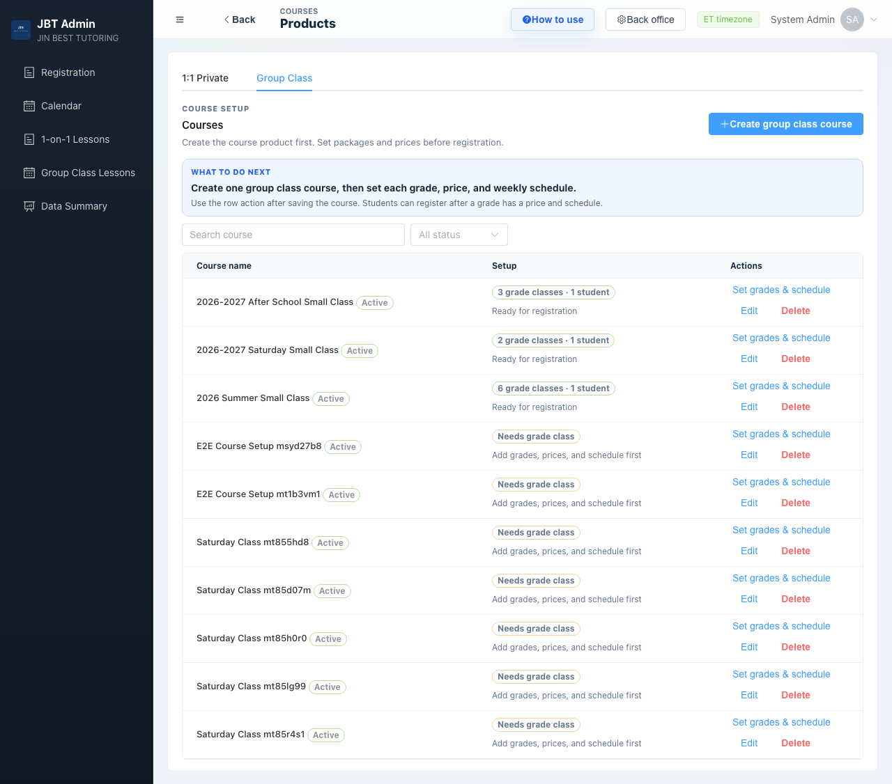

### 步骤 2：填写课程名称

在弹窗里填写 **Course name（课程名称）**，例如 `2026 秋季周六班`。

- **Sort**：排序号，数字越小越靠前，可保留默认。
- **Status**：状态，保持 **Active（启用）**。
- **Notes**：备注，可不填。

填好后点击 **Create course（创建课程）**。

> 💡 这一步只是先把课程「建出来」。年级、价格、上课时间在下一步设置。

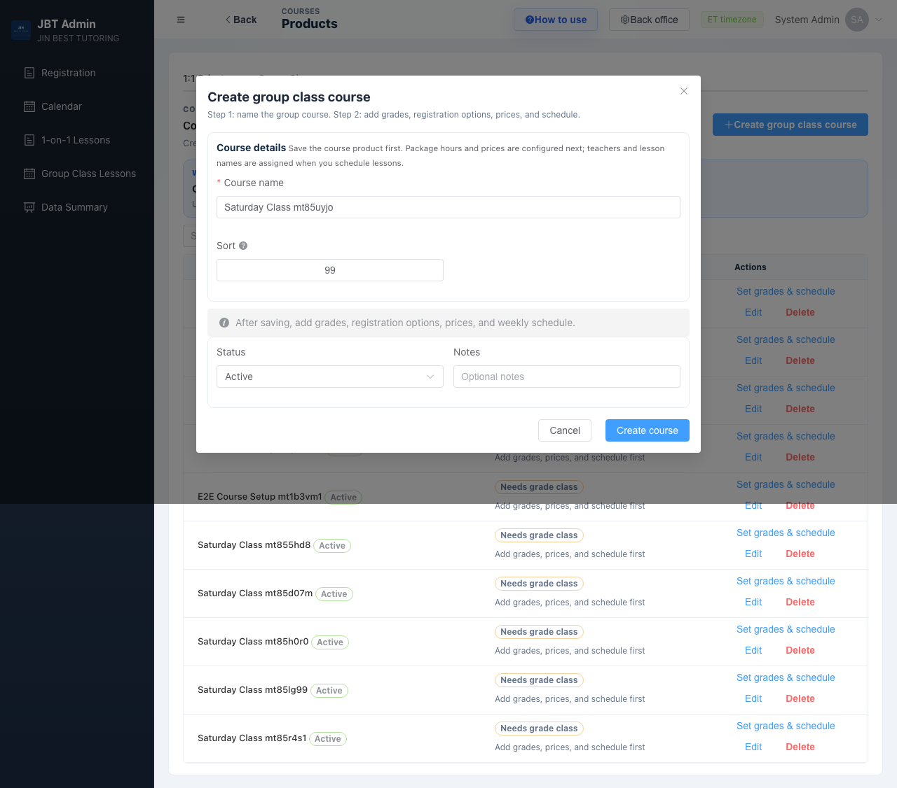

### 步骤 3：继续设置

创建成功后，顶部会提示 **Course created（课程已创建）**，并出现一张绿色卡片。
点击卡片上的 **Continue setup（继续设置）** 进入下一步。

> 如果暂时不想设置，可以点 **Later（稍后）**，之后在列表里点该课程的 **Set grades & schedule（设置年级和排课）** 回到这里。

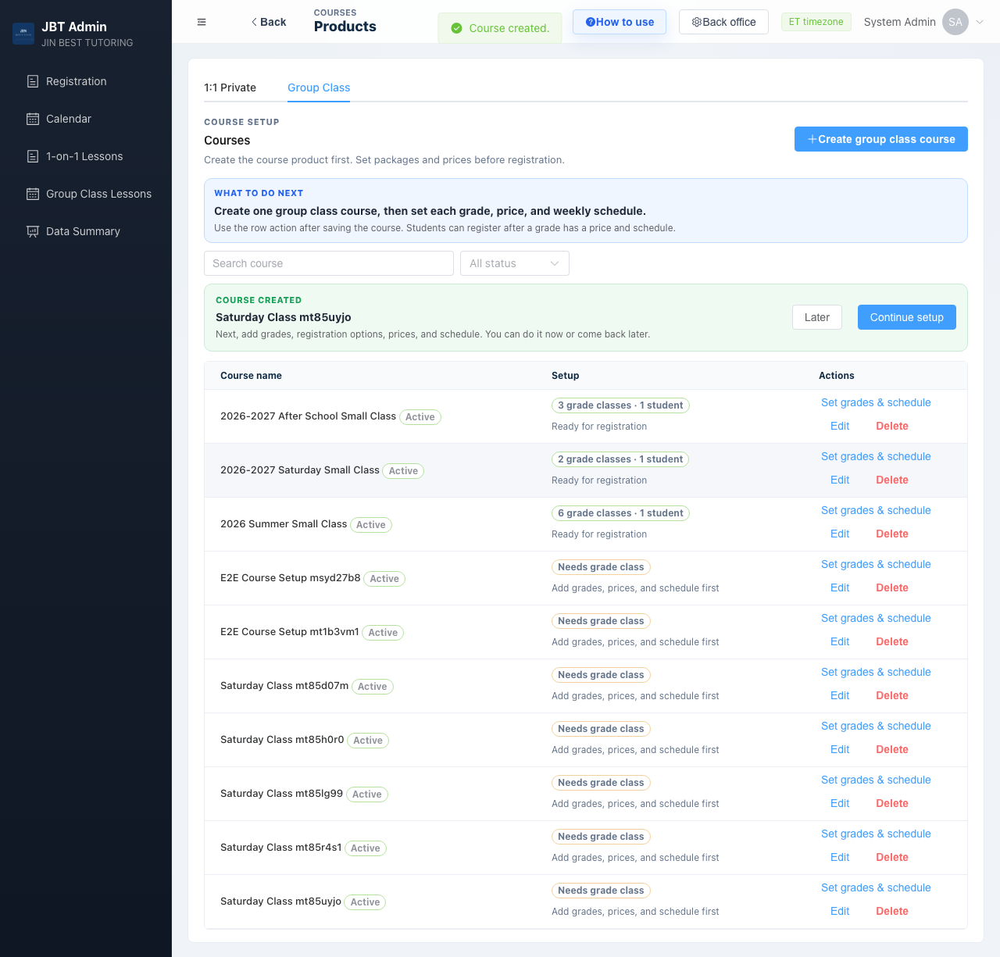

### 步骤 4：进入年级班设置页

进入 **Set Grade Classes & Registration Options（设置年级班与报名选项）** 页面。

- 左侧是课程列表，确认已选中你刚创建的课程（高亮显示）。
- 右上角点击 **Add grade（添加年级）** 开始添加第一个年级班。

> 一个「课程 + 年级」= 一个年级班（Grade Class）。同一个年级下的所有报名选项（如 2 个月 / 学期 13 次课）都属于这个年级班。

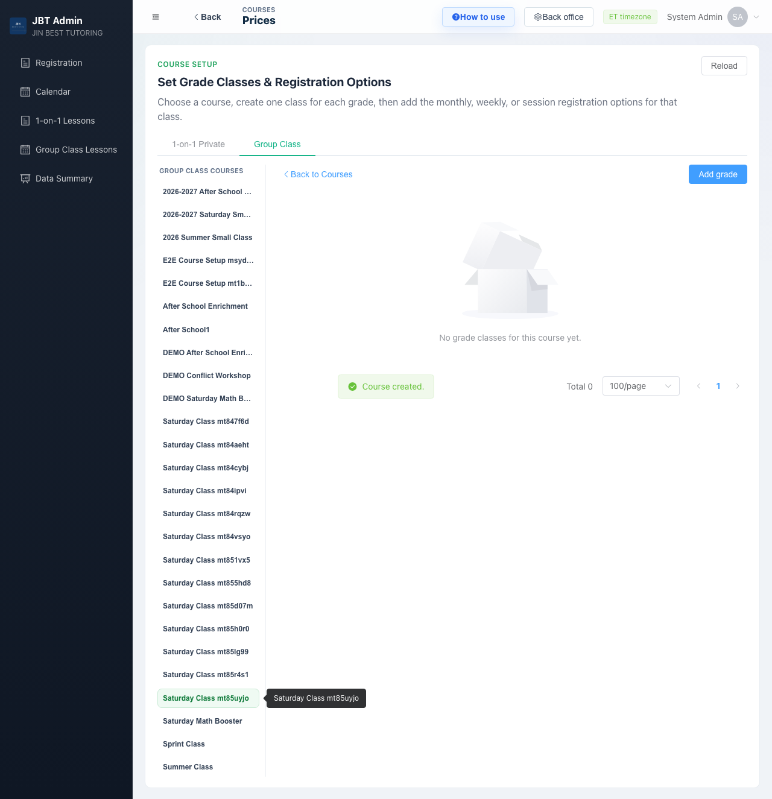

### 步骤 5：填写报名选项

> **什么是「报名选项（Registration option）」？**
> 报名选项就是**学生报名时能选的一种购买方式**，即一个「报几次课 / 报几个月 + 多少钱」的组合。
> 例如同一个年级可以有：「学期 13 次课 = ¥1199」「按 2 个月 = ¥800」「全年 = ¥3000」——每一种就是一个报名选项，学生报名时在这些选项里挑一个。
> 点击 **Add registration option** 就是给这个年级新增一种这样的购买方式。（一对一里叫「课时包 Hour Package」，本质相同。）

在弹窗中依次填写：

1. **Grade（年级）**：选择或输入年级，例如 `G1-G5`。
2. **Count by（计费方式）**：
   - **By session（按课时）** — 例如「学期 13 次课」
   - **By month（按月）** — 例如「2 个月」
3. **Number of sessions / months（课时数 / 月数）**：填对应的数量，例如 `13`。

下方的 **Registration label（报名标签）** 会自动生成，例如 `13 sessions`。

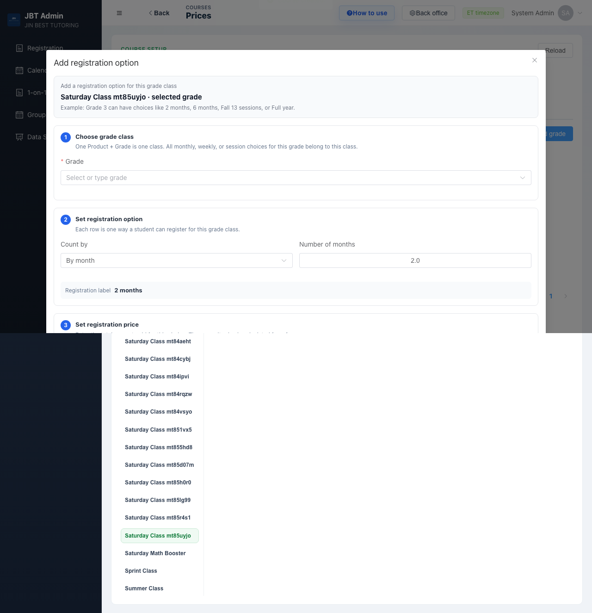

### 步骤 6：设置价格

在 **Set registration price（设置报名价格）** 部分填写：

- **Full-day price（全天价格）**：这个报名选项的总价，例如 `1199`。
- **Half-day price（半天价格，可选）**：如有半天班可填，例如 `699`。

系统会自动算出 **Calculated session price（单次课价格）** 供参考。

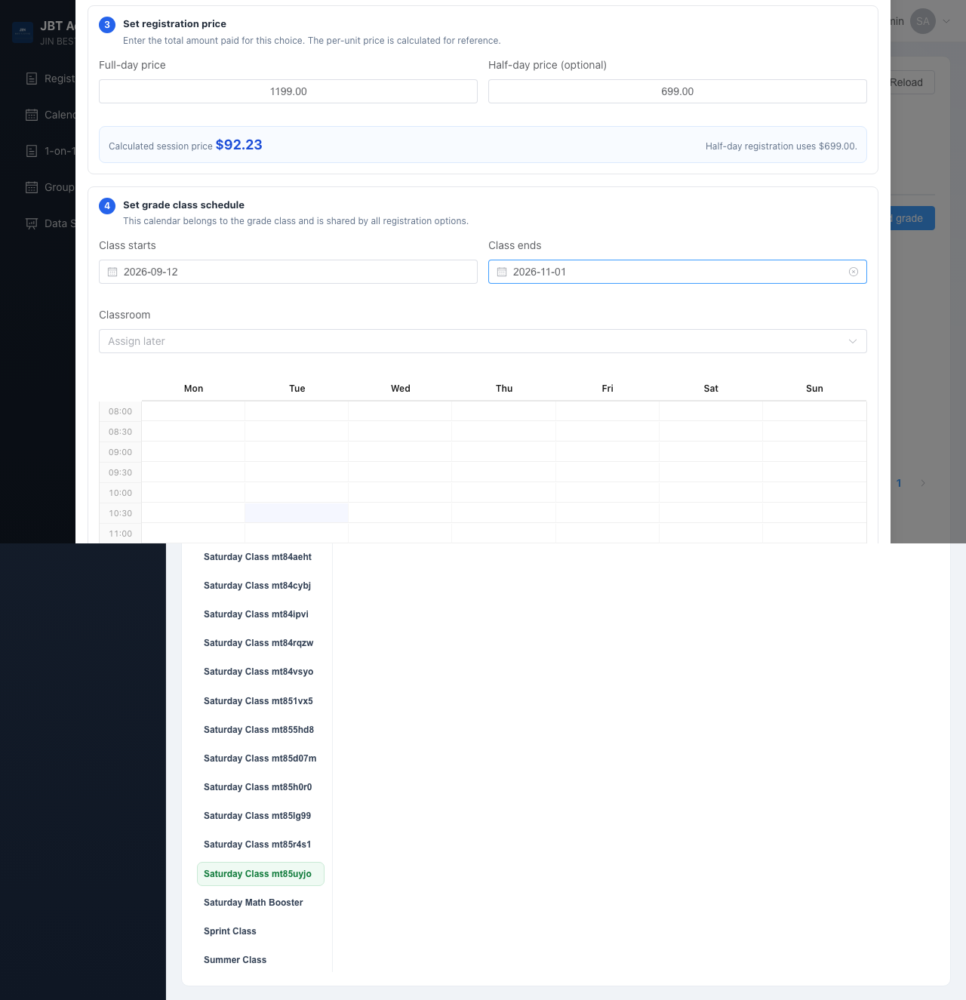

### 步骤 7：设置每周上课时间

在 **Set grade class schedule（设置年级班排课）** 部分：

1. 填写 **Class starts（开班日期）** 和 **Class ends（结班日期）**，例如 `2026-09-12` 到 `2026-11-01`。
2. 在下方周历上，**按住鼠标拖动**选出上课时段，例如周六 `09:00–12:00`。
3. 选中后下方会出现该时段一行，设置：
   - **Applies to（适用范围）**：例如 `All students（全部学生）`。
   - **Teacher（老师）**：可先不选，排课时再指定。
   - **Taught subject（授课科目）**：例如 `Chemistry`。

确认无误后点击 **Save registration option（保存报名选项）**。

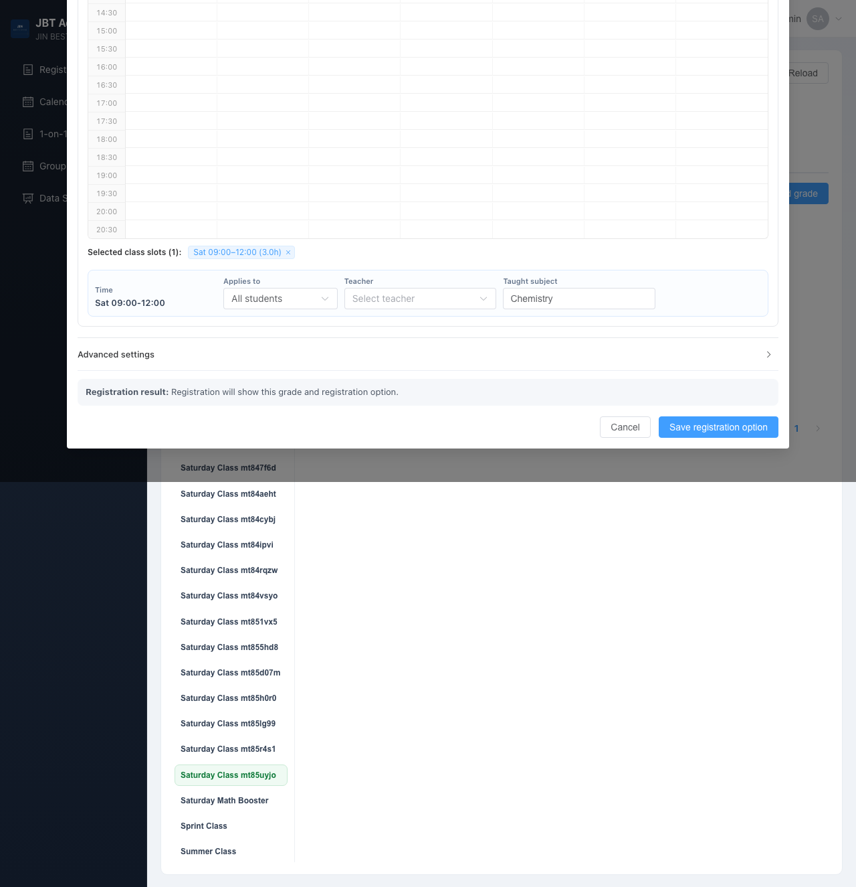

### 步骤 8：完成

保存成功后提示 **Registration option created（报名选项已创建）**，
该年级班和报名选项会显示在列表里，学生即可报名。

如需给这个年级添加更多报名选项（如「全年班」），点右上角 **Add registration option**；
如需添加其他年级，点 **Add grade**。

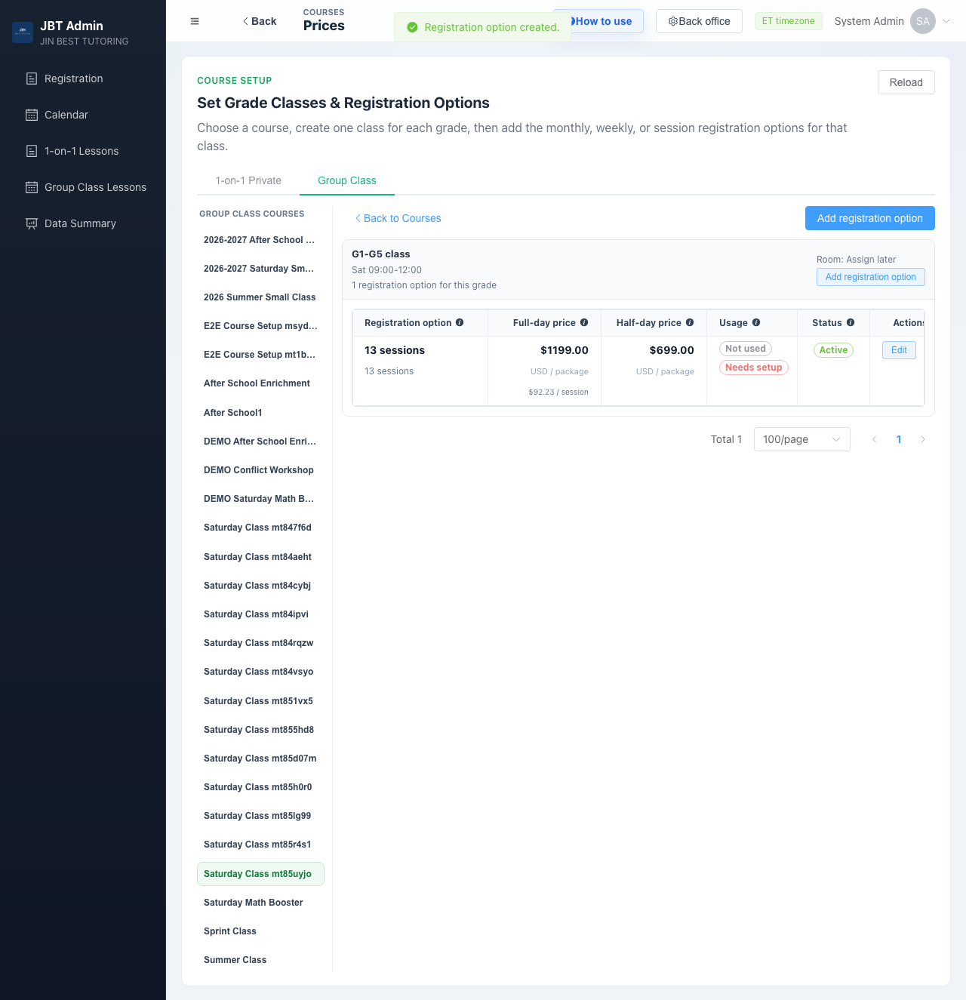

---

## 二、创建一对一（1:1 Private）

一对一的创建流程与团课类似，区别在于第 2 步是设置 **Hour Package（课时包）**，没有每周固定排课。

### 步骤 1：进入课程列表

在 **Courses** 页面点击 **1:1 Private** 标签页，
右上角点击 **＋ Create 1-on-1 course（创建一对一课程）**。

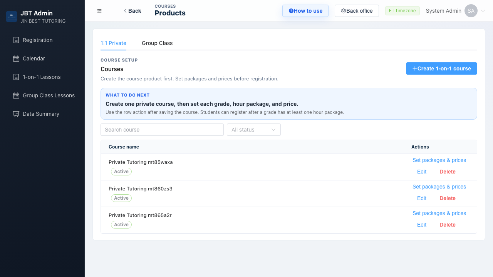

### 步骤 2：填写课程名称

填写 **Course name（课程名称）**，其他保持默认，点击 **Create course（创建课程）**。
创建成功后同样点击 **Continue setup（继续设置）**。

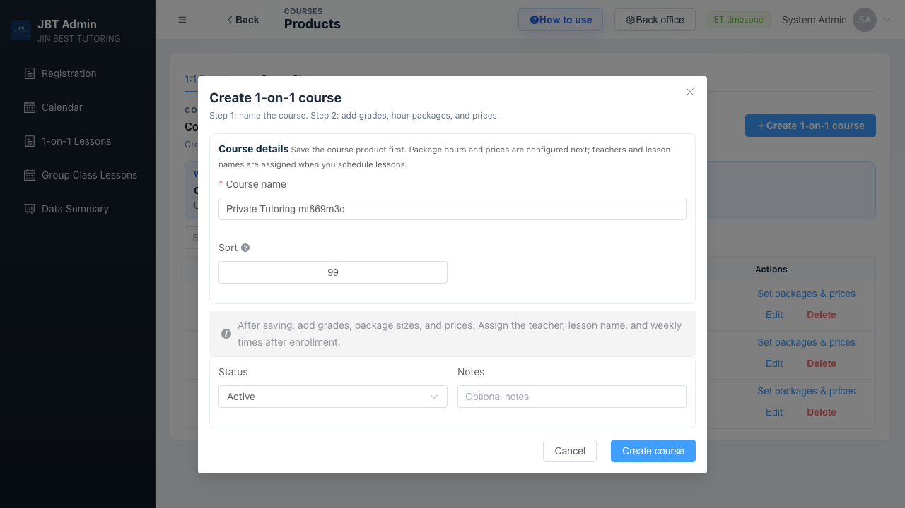

### 步骤 3：添加课时包

进入设置页后，右上角点击 **Add hour package（添加课时包）**，在弹窗中填写：

1. **Grade（年级）**：选择年级，例如 `G6-G8`。
2. **Package name（课时包名称）**：例如 `60 hours`。
3. **Package hours（课时数）**：点选一个预设按钮（`20h / 40h / 60h / 80h / 100h / 120h`），或选 **Custom** 自定义。
4. **Package price（课时包价格）**：填写总价，例如 `3600`。

填好后点击 **Save hour package / Save registration option（保存课时包）**。

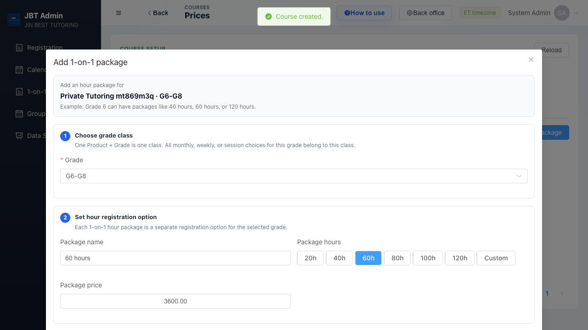

### 步骤 4：完成

保存成功后，该年级下的课时包会显示在列表里（如 `60 hours — $3600.00 — $60.00 / hour`），学生即可报名。

> 一对一不需要固定每周时间，老师和上课时间在学生报名后单独排课。

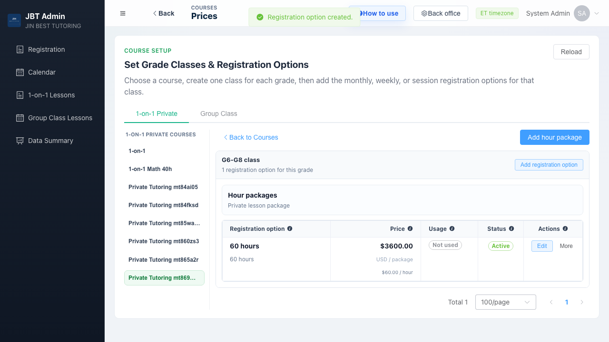

---

## 常见问题

**Q：创建了课程，学生为什么报名时看不到？**
A：课程只是第 1 步。必须完成第 2 步——为年级班设置好报名选项和价格（团课还需设置上课时间），学生才能报名。列表里状态显示 **Needs grade class（需设置年级班）** 说明还没设置完。

**Q：一个课程可以有多个年级、多个价格吗？**
A：可以。一个课程下可以添加多个年级班（Add grade），每个年级班下可以添加多个报名选项 / 课时包（Add registration option）。

**Q：填错了怎么办？**
A：在设置页找到对应的行，点击 **Edit（编辑）** 即可修改。
